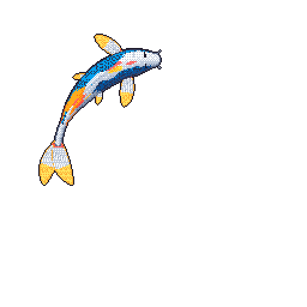

# Onat Özmen

**I build AI products from start to finish.** I work on infrastructure for AI
agents and on tools for health, law, and real estate. My work covers data,
evaluation, backend, interface, and deployment.

I currently build **Muddei**, a verifiable legal research platform, and **Deed**,
a contract-first programming language for agents. I also contribute to
**OpenHands**, with 15 merged pull requests across its agent SDK, extensions,
and automation.

Before this, I worked at Microsoft. I built agent solutions with M365 Agents
Toolkit and Copilot Chat. I also built RAG search with Azure OpenAI.
I study CTIS at Bilkent University. I expect to graduate in 2027.

### What I build

- **[Muddei](https://muddei.com)**: a verifiable legal research platform for
  Turkish law. It keeps every answer tied to its source. Built with Python and
  TypeScript.
- **[Deed](https://github.com/deed-lang/deed)**: a contract-first language for
  agents. A function signature is a promise. The compiler checks it. Built with
  Rust.
- **[KlinikMCP](https://github.com/onatozmenn/klinik-mcp)**: 18 tools that use
  10 or more official sources for Turkish drug, interaction, and reimbursement
  data. The server helps doctors and pharmacists. Built with Python, FastMCP,
  and Docker.
- **[sold](https://github.com/onatozmenn/sold)**: UYAP auction data with source
  tracking. The project also has an atlas that compares court appraisals with
  final sale prices for Turkish property valuation. Built with Python and
  econometric models.
- **[Audio Transcription](https://audio-transcription.app)**: privacy-first
  transcription. It runs locally in the browser on desktop. It uses a secure
  cloud fallback on mobile. Built with Next.js and TypeScript.
- **[Atlas](https://github.com/atlas-depot/atlas)**: a personal assistant for
  scattered context. This is our graduation project. I built the WorkOS browser
  sign-in and the protected API session boundary. Built with TypeScript, React,
  and Hono.

### Open source

- **[OpenHands](https://github.com/OpenHands)**: 15 merged pull requests across
  the core repo, software-agent-sdk, extensions, and automation. I worked on
  agent server lifecycle, MCP startup resilience, ACP isolation, and settings
  behavior. [See the pull requests](https://github.com/search?q=author%3Aonatozmenn+org%3AOpenHands+type%3Apr&s=created&o=desc).
- **[modelcontextprotocol/rust-sdk](https://github.com/modelcontextprotocol/rust-sdk/pull/1049)**:
  bounded the incoming line buffer in AsyncRwTransport. This prevents memory
  exhaustion from an unterminated line. Merged.
- **[canonical/multipass](https://github.com/canonical/multipass/pull/5096)**:
  wildcard support in instance-to-host transfers. C++, 500 or more lines.
  In review.

### Technologies

I work with Rust, Python, TypeScript, Go, C++, C#, PostgreSQL, Azure OpenAI,
MCP, and Docker.

### Contact

[Portfolio](https://onatozmenn.github.io/)
[LinkedIn](https://www.linkedin.com/in/onat-ozmen/)
[Email](mailto:onatozmen44@gmail.com)

### Recent open-source pull requests

<!-- prs:start -->
- [test(sdk): cover env-only lookup with a readable dotenv file](https://github.com/OpenHands/software-agent-sdk/pull/5347) on **OpenHands/software-agent-sdk**
- [fix(settings): refresh profile list even when title cleanup fails](https://github.com/OpenHands/OpenHands/pull/17521) on **OpenHands/OpenHands**
- [fix(transport): bound the incoming line buffer in AsyncRwTransport](https://github.com/modelcontextprotocol/rust-sdk/pull/1049) on **modelcontextprotocol/rust-sdk**
- [feat(agent-server): add stop operation for a single BashCommand](https://github.com/OpenHands/software-agent-sdk/pull/5348) on **OpenHands/software-agent-sdk**
- [fix(iterate): ship real vendor manifest dirs for Codex install](https://github.com/OpenHands/extensions/pull/607) on **OpenHands/extensions**
- [docs: point agents at schema discovery from help and README](https://github.com/elastic/cli/pull/690) on **elastic/cli**
<!-- prs:end -->

  <picture>
    <source media="(prefers-color-scheme: dark)" srcset="https://raw.githubusercontent.com/onatozmenn/onatozmenn/output/snake-dark.svg">
    
  </picture>

Contribution graph, redrawn every week.

